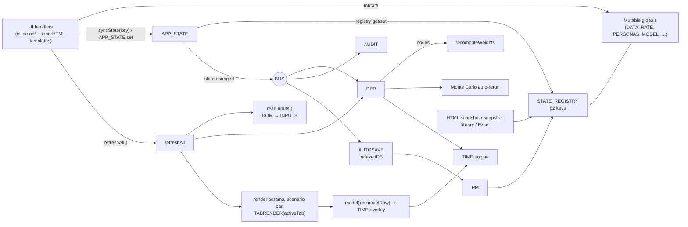

# AgentCase — Architecture

> Applies to **AgentCase v18.10** (`AgentCase_v18_10_EN.html`, ≈25,475 lines, ≈5.0 MB).
> Line references (`L1234`) were taken on v18.8 and shift with every release — in v18.9 they move by roughly
> +60 lines after the helper block at the top of the main script and by up to −1,000 further down (dead code removed).
> Search for the quoted identifier; do not trust a number.
> Supersedes the in-app "Architecture" chapters (`arch-layers`, `arch-content`) and the historical
> companion `AgentCase_Architecture_v12.25.html`.

## 1. Overview

AgentCase is a single, self-contained, offline HTML file (≈25,475 lines, ≈5.0 MB) that builds an
*agentic transformation* business case:

```
AS-IS team × rate card × SDLC/regulatory artefact scope
  → automation potential, glass ceiling, adoption ramp (S-curve)
  → TO-BE human FTE + agent vFTE
  → run cost, savings, NPV, payback
  → Monte Carlo, strategy ranking, decision verdict
```

Key properties:

- **No build step, no framework, no network.** Plain global-scope JavaScript (≈1,140 top-level
  functions) operating on mutable globals. Chart.js, ExcelJS and the Ubuntu font are inlined. Works
  from `file://`.
- **Globals are the source of truth.** A set of architectural engines (BUS, APP_STATE, PM, DEP,
  AUDIT, TIME — added v14.17 → v18.5) wraps those globals and is exposed as `window.AgentCaseArch`.
- **The file persists itself.** "Save HTML snapshot" clones the live DOM, replaces the embedded
  state script and downloads a new copy that restores the case when opened.

## 2. Physical layout of the file

| Lines | Block | Size | Notes |
|---|---|---|---|
| L1–5 | doctype, `<html lang="en">`, `<title>` | – | |
| L6 | boot-flicker gate `<style>` | <1 KB | `html:not(.boot-ready)` hides sidebar, `#groupNavBar`, `#home`, `#scenarioBar` until boot completes |
| L7–23 | Chart.js 4.4.1 | ≈205 KB | global `Chart` |
| L24–70 | ExcelJS 4.4.0 | ≈948 KB | global `ExcelJS` (browserify bundle) |
| L71–75 | `<style id="cg-fonts">` | ≈1.24 MB | 3 × Ubuntu `@font-face` as base64 |
| L76–327 | application CSS | ≈25 KB | hard-coded Capgemini Engineering palette, no CSS variables |
| L328–6455 | HTML markup | ≈960 KB | header, `#scenarioBar`, sidebar, `<main>` with one `.tab-content` per section, command palette, footer |
| L6456–25400 | **main application script** | ≈1.56 MB | all logic, data catalogues, engines, boot calls |
| L25401 | `<script data-agentcase-snapshot="1">` | ≈36 KB | baked state: `applySnapshotState({...})` |
| L25402–25446 | session-persistence wiring | ≈3 KB | `AUTOSAVE.init()`, debounced autosave, adds `boot-ready` |

The static markup also contains a stale render of dynamic regions (sidebar, home cards, scenario
bar). The L6 gate hides them until JavaScript rebuilds them.

### 2.1 Main-script map

| Lines (approx.) | Content |
|---|---|
| L6457 | `const DATA` (53 artefacts, 11 phases L0/V1–V7/L8–L10, 11 industries, grades, locations), `let RATE` (rate card) |
| L6553–6580 | **readInputs seam**: `INPUTS`, `readInputs()`, `V()`, `C()`, `P()` |
| L6583–6850 | core model helpers: `computeGlassCeiling`, `recomputeWeights`, `activeArtefacts`, `phaseScope`, `autoTechCap`, `applyScopeAuto` |
| L6849–7330 | scenarios, savings decomposition, Financial export, legacy Sales-build wizard |
| L7333–7700 | `REG_CATALOG` (47 norms, 370 regulatory artefacts), `AGENT_CATALOG` (16 agents), `LOOP_PAIRS` |
| L7705–8170 | AI readiness (`READINESS_DIMS`), quarterly tracker |
| L8168–8260 | scenario engine (`scenarioModel`, `scenarioSet`) |
| L8259–8560 | **persona system**: `SECTION_CATALOG`, `PERSONAS`, `PERSONA_SECTIONS`, `PERSONA_SECTION_ORDER`, Advanced unlock |
| L8700–9080 | skill map, TO-BE team composition, TO-BE location split |
| L9080–9260 | Monte Carlo (`MC_PARAMS`, `runMonteCarlo`, auto re-run) |
| L9260–9500 | guided sequence / wizard (`WIZ`) |
| L9595–10165 | assumptions register, strategies, decision intelligence, results |
| L10165–10560 | persona pills / nav, `GROUPS`, `GROUP_COLORS`, **Section Board** data model (`VARIABLE_REGISTRY`, `DYNAMIC_SECTIONS`) |
| L10557–11265 | persona management UI (CRUD, Menu layout board, Assignment board) |
| L11266–11312 | Factory meta-model state arrays, `SNAPSHOTS` |
| L11316–12930 | **AME** (Agentic Modelling Engine) P0–P6 |
| L12821–13090 | **STATE_REGISTRY**, **BUS**, **APP_STATE**, `syncState`, `collectSnapshotState`, `applySnapshotState` |
| L13091–13212 | calculation-package staleness check, **PM** |
| L13215–13597 | **AUTOSAVE** (IndexedDB) and Session manager UI |
| L13600–14035 | `saveHtmlSnapshot`, snapshot library, golden case, Golden Case Transition |
| L14038–14380 | `STATUS_LIFECYCLE`, **`model()` / `modelRaw()`**, `COEF`, `targetTeam` |
| L14380–17000 | tab renderers (Annual, Monthly, Compare, FTE/vFTE, funnel, S-curve editor, ROI, KPI, Agent directory, Due diligence …) |
| L17005–18000 | Excel export / import (`IO_PARAMS`, `exportParams`, `importParams`) |
| L18251 | `TABRENDER` map (section id → render function) |
| L18320–19290 | dynamic-section generator, Data Model and Calculation Engine sections |
| L19289–21058 | Gantt, Factory UI |
| L21060–21800 | **DEP**, `refreshAll`, **AUDIT** and its registered checks |
| L21794–22520 | **TIME** (Time Engine), canonical payback/NPV, `window.AgentCaseArch` |
| L22520–22860 | navigation (`goTab`, group nav bar, section help, Fast-Track, scenario bar, home, command palette) |
| L22862–25230 | convergence module (engagement context, maturity map, HRI, knowledge hub, glossary, EV waves, section dependencies) |
| L25233–25399 | `ensureConvergenceBoot`, top-level boot calls |

## 3. Architecture at a glance



## 4. Core primitives

### 4.1 Mutable globals and the readInputs seam (v12.16)

- `readInputs()` copies every `input`, `select` and `textarea` value (by `id`) into
  `INPUTS = {v, c, ready}` once per refresh cycle.
- `V(id)` (string), `C(id)` (checked) and `P(id)` (parseFloat) read from `INPUTS`, falling back to
  the DOM before boot. The calculation core reads only through these accessors, so it is DOM-free.
- Monte Carlo, strategies, scenarios and convergence checks temporarily overwrite `INPUTS.v`, call
  `model()`, then restore.
- **Consequence:** DOM element ids *are* the parameter namespace. Duplicate ids break the seam.

### 4.2 STATE_REGISTRY (L12821)

A declarative list of `{key, get, set}` descriptors over the globals: 81 literal entries plus the keys pushed
later in the script — `engageCoef`, and since v18.9 `scurve` (S-curve points / family / active curve) and
`stratApplied` (the strategy-neutral base, §6.2) — 84 keys in total. It is the single schema used by snapshots,
autosave, APP_STATE, DEP and AUDIT. Main key families:

- **Case inputs:** `dom` (all DOM input values), `customerName`, `teamIn`, `RATE`, `targetLocPct`,
  `selectedArtefacts`, `phaseOff`, `artefactsEdited`, `COEF`, `QUALITY`, `TOKEN_MODELS`, `skillMap`,
  `tobeLocSplit`, `lifecycleUse`, `lifecyclePos`, `statusLifecycle`, `engageCoef`, `MATURITY_MAP`.
- **Regulatory:** `regUse`, `regInclude`, `selectedNorms`, `selectedRegArtefacts`,
  `regArtefactsEdited`, plus import-only legacy shims `REG_OVERRIDES`, `REG_HUMAN_SUP`, `REG_EFFORT`.
- **Navigation / personas:** `PERSONAS`, `PERSONA_SECTIONS`, `PERSONA_SECTION_ORDER`, `GROUPS`,
  `GROUP_COLORS`, `sectionGroups`, `SECTION_NAV_STYLE`, `SECTION_DEPS`, `SECTION_DEPS_DESC`,
  `dynamicSections`.
- **Analysis:** `mcParams`, `mcAuto`, `strategyDefs`, `stratWeights`, `assumptValidated`,
  `DD_STATE`, `DD_SENS`, `DORA_ANCHORS`, `THROUGHPUT_ANCHORS`, `MODEL` (AME), `trackActuals`,
  `readinessAns`.
- **Factory meta-model:** `VISION`, `PORTFOLIO_ITEMS`, `EPICS`, `FEATURES`, `STORIES`, … ,
  `BACKLOG_ITEMS`, `FG_PARAMS`, `FG_PROVENANCE`.
- **Snapshots:** `namedSnapshots`.

Setters normalise their input (for example `teamIn` snaps FTE to 0.5, `MODEL` re-runs
`modelBoot()`). Getters and setters hand out and accept the live global objects, so **the snapshot boundary
copies**: `collectSnapshotState` and `applySnapshotState` pass every value through `snapClone()` (v18.9) — never
store a reference to a snapshot's objects in a global.

### 4.3 BUS — event bus (v14.17, L12948)

A small pub/sub: `on(evt, fn) → off`, `emit(evt, payload)` (each handler is wrapped in try/catch).

| Event | Emitted by | Main subscribers |
|---|---|---|
| `state:changed` `{path, before, after, source}` | `APP_STATE.set` | DEP (mark dirty), AUDIT (log), autosave (2 s debounce) |
| `calc:done` | `DEP.flushDirty` | – |
| `calc:staleness` | `calcStalenessCheck` | – |
| `snapshot:collected` / `snapshot:applied` | PM | – |
| `persona:changed` | `setPersona` | – |
| `tab:activated` | `goTab` | Monthly playback (pause) |
| `audit:checks-done` | `AUDIT.runChecks` | – |

### 4.4 APP_STATE — JSON facade (v14.17, L12964)

`get(key)`, `set(key, value, source)` (registry `set`, then emits `state:changed`), `keys()`,
`toJSON()` (all keys plus `personaSchemaVersion: '15.0'`, `schemaVersion: '15.0'`,
`currentPersona`). Most handlers mutate a global in place and then call `syncState(keys, source)`
(≈250 call sites), which re-sets the same value so that BUS/DEP/AUDIT see the change.

### 4.5 PM — Persistence Manager (v14.18, L13162)

- `serialize()` = `collectSnapshotState()` + schema versions; emits `snapshot:collected`.
- `hydrate(obj)` resolves the incoming version, runs registered migrations in order, then
  `applySnapshotState(obj)`; emits `snapshot:applied`.
- Only one migration is registered (`<12.43 → 12.43`, a documented no-op). Real migrations are done
  imperatively (§8.3).
- Only AUTOSAVE goes through PM. HTML snapshots, the snapshot library and Excel call
  `collectSnapshotState` / `applySnapshotState` directly.

### 4.6 DEP — dependency engine (v14.19, L21076)

`node(id, reads, compute)`, `markDirty(path)`, `flushDirty()`. With `FULL_REFRESH = true` (the
default) every node runs in registration order. With `false`, only nodes whose `reads` match a
dirty path run (QA toggle: `window.__DEP_FULL_REFRESH__ = false`).

| Node | Reads | Compute |
|---|---|---|
| `derived.weights` | `artefactsEdited`, `regArtefactsEdited`, `lifecycleUse`, `lifecyclePos` | `recomputeWeights()` |
| `derived.mcHook` | all | `mcAutoHook()` (Monte Carlo auto re-run when stale) |
| `time.engine` | all | `TIME.rebuild({mode, curveModelId})` |

Not to be confused with `SECTION_DEPS`, the section-level dependency registry (§6.11).

### 4.7 refreshAll — the recalc/render cycle (L21157)

```
readInputs() → DEP.flushDirty() → renderParams() → renderScenarioBar() → TABRENDER[activeTab]()
```

Only the active tab is re-rendered. Other tabs render when opened through `goTab` (via
`TABRENDER[id]`, scheduled at +50 ms). Renderers call `model()` / `teEngineNow()` afresh; results
are not cached between renders.

### 4.8 AUDIT — audit engine and logic checks (v14.20, L21185)

- Ring buffer (500 entries) of `state:changed` events; values over ≈2 KB serialised are stored as a size marker.
- `registerCheck(id, paths, fn, label)` / `runChecks()` run invariants against
  `APP_STATE.toJSON()`. 42 checks are registered (v18.9 added `CC-OV-01`, "the Time Engine overlay applied to
  `model()` without error"): AME invariants (`CC-LC-*`, `CC-VT-*`, `CC-SC-*`,
  `CC-MC-*`, `CC-CB-01`, `CC-FL-01`, `CC-EV-*`), Monthly playback (`CC-MP-*`), Time Engine
  (`TE-05` … `TE-14`, `TE-CURVE`, `TE-HZN`, `TE-DEP`), agents (`CC-AG-02`) and section
  dependencies (`CC-DEP-01/02`).
- Results are shown in the 🔍 Logic verification section (`verif`), merged with older hand-written
  check sets (`CC-CTX-*`, `CC-KH-*`, `wave1Checks` … `wave5Checks`).

### 4.9 TIME — Time Engine (v18.5, L21794–22520)

The only engine that computes. It is pull-based, with four layers:

1. **L0 curve adapter** `rampAt(t)` — `legacy.flatAnnual`, `logistic.default`, `gompertz.default`,
   `bass.default`, `spline.default` (live default since v18.6).
2. **L1 derivation kernel** `monthAt(t)` (memoised).
3. **L2 path accumulator** — `cumulativeAt`, `payback`.
4. **L3 aggregation** — `year(y)`, `years()`.

Facade: `TIME.for(opts)`, `TIME.thin(opts, rate)` (row-free aggregate for Monte Carlo draws),
`TIME.rebuild`, `TIME.current`, `TIME.registerAdapter`. Helpers `teEngineNow()`,
`paybackMonthsCanonical()` and `npvCanonical(rate)` (default `MODEL.CASE.discountRate`, 8 %) are
the single source for payback and NPV.

`materialise()` returns the **calculation package**
(`schemaVersion: 'agentcase.calculation.v1'`, `calculationVersion: 'agentcase.timeengine.v1'`,
`inputHash`, `curveModelId`, monthly/annual series, milestones, headline), which is stored in every
snapshot and compared on load (§8.3).

### 4.10 Calculation core: `phaseScope()`, `modelRaw()`, `model()`

- `phaseScope()` (L6683) computes the effort-weighted scope over `activeArtefacts()`, with weight
  `w = effort × lifecycleWeight`.
- `computeGlassCeiling()` (L6597) = Σ(w × humanSup) / Σw over active SDLC and regulatory
  artefacts, unless forced.
- `modelRaw()` (L14229) is the original annual computation: team cost, automation potential,
  ceiling, engagement coefficients, Y1–Y3 ramps, setup, tokens, infrastructure, run team, knowledge
  hub, verification tax, loops, and AME overlays when their flags are on.
- `model()` (L14150) calls `modelRaw()` and then, unless the active curve is `legacy.*`, overwrites
  the annual arrays with `TIME.for(...).years()`. Every consumer therefore reads the same
  monthly-summed figures (the overlay contract is documented in the Calculation Engine section). If the
  overlay throws, `model()` falls back to the raw flat result but sets `_overlayError` and logs once; `CC-OV-01`
  reports it.
- Coefficients: `COEF` (13 promoted coefficients, v18.7, catalogued in `DD_COEFFICIENTS`),
  `ENGAGE_COEF` (MSC/MSI/STA engagement contexts), `MATURITY_MAP` (L1–L4 thresholds, v18.6).

### 4.11 `window.AgentCaseArch` (L22514)

A read-only, non-enumerable global:
`{VERSION: '18.8.0', BUS, APP_STATE, PM, DEP, AUDIT, TIME}`. It is the documented surface for QA
scripts (Playwright). `appVerTag()` / `appVerFileTag()` derive `v18.8` / `v18_8` from it for file
names and autosave records.

### 4.12 Shared helpers (top of the main script, v18.9)

| Helper | Use |
|---|---|
| `escHtml(s)` | **every** user-editable or imported string placed in `innerHTML` text or a quoted attribute |
| `escJs(s)` | the same string placed inside a single-quoted JS string of an inline handler: `onclick="f('${escJs(id)}')"` |
| `safeId(s)` / `cleanText(s, max)` | imported ids (`[A-Za-z0-9_.:-]`, never `__proto__`) / imported free text |
| `snapClone(v)` | deep copy at the snapshot boundary (§4.2) |
| `numOr(x, d)` | keep an explicit 0 (unlike `x \|\| d`) |
| `roiCanonical`, `fmtRoiPct`, `fmtPayback`, `fmtChg` | the one ROI / payback / delta convention |
| `parseLocalDate`, `addMonthsLocal` | calendar dates in local time (a bare `new Date('2026-09-01')` is UTC) |
| `hashStr(s)` | content hash for change detection |
| `scEnginePts()` | the spline's control points as the engine reads them (scaled by ramp speed × HRI, capped) |
| `a11yEnhance(root)` | accessibility pass (names for form controls, keyboard access for click-only elements); runs through a throttled `MutationObserver` |

## 5. Boot sequence

There is no `DOMContentLoaded` handler. Scripts sit at the end of `<body>` and run top to bottom.

1. **L6** — CSS gate hides the dynamic chrome.
2. **L7–70** — Chart.js and ExcelJS define their globals.
3. **Main script, top level** — seeds catalogues and defaults (`seedRegArtefacts`,
   `seedArtefactSeq`, `modelBoot`, `recomputeWeights`), registers BUS subscribers, DEP nodes and
   AUDIT checks, defines `window.AgentCaseArch`, attaches navigation and keyboard listeners
   (Ctrl/Cmd+K palette).
4. **Boot tail (L25329–25396)** — builds selectors, `applyScopeAuto()`, `renderParams()`,
   `renderScenarioBar()`, `renderHome()`, `readInputs()`, captures `INPUTS_DEFAULTS`,
   `initAdvancedLock()`, `setPersona(default)`, `renderWizBar()`, section tag badges.
   The golden case is deliberately *not* captured here.
5. **L25401 boot-restore** — `applySnapshotState(baked)`:
   suspend autosave → `set()` every registry key present → legacy regulatory shim →
   `ensureConvergenceBoot()` → `setPersona(...)` → `refreshAll()` (first DEP flush and first
   `TIME.rebuild`) → `calcStalenessCheck()` → `ensureGoldenSnapshot()` (captures the protected
   golden snapshot if none exists) → resume autosave.
6. **L25402–25446** — `AUTOSAVE.init()` (opens IndexedDB, offers a Restore/Discard banner if a
   autosave newer than the file's own state exists for this tab; it never auto-restores), wires the
   2 s debounced autosave on `state:changed` **and** on any `input` / `change` of a form control, plus
   save-on-hide and `pagehide`, then adds `boot-ready`, which reveals the chrome. None of this runs in a framed
   copy of the app (§6.6).

## 6. Feature subsystems

### 6.1 Personas and navigation

- **Sections:** 79 entries in `SECTION_CATALOG` (L8260) of
  `{id, group, groupSeq, label, description, tag?, mvp?, protected?}`. A section id is also its DOM
  id, its `TABRENDER` key and its nav `data-tab`. Ids are kebab-case (`model-convergence`).
- **Groups:** 14 build-stage groups in `GROUPS` (L10181) — frame, baseline, scope, tune, verify,
  economics, stress, verdict, defend, present, refshare, configure, factory, model-engine.
- **Personas** (`PERSONAS`, L8347): `builder` (default), `clientcase` (v18.8 workshop storyline),
  `admin`, and `advanced` (sees everything; unlocked by `?persona=advanced`, `#advanced`,
  Ctrl/Cmd+Alt+A, or 5 clicks on the title — a UI de-clutter, explicitly *not* access control).
  Membership lives in `PERSONA_SECTIONS`, per-persona order in `PERSONA_SECTION_ORDER`.
- **Navigation:** `renderPersonaNav` (sidebar), `goTab`, collapsed-menu mode with
  `#groupNavBar` (`SECTION_NAV_STYLE` buttons or tabs), Welcome cards per group, Fast-Track Path
  (MVP sections only), command palette (Ctrl/Cmd+K), per-section "?" help panels.
- **Guided sequence (wizard):** `WIZ` (L9264), steps stored in `persona.seq`, per-step section
  picker, focus mode, one-click generator; `story-summary` capstone.
- **Persona management** (`personas` section): persona and group CRUD, colours, default persona,
  tag/MVP editor, Menu layout board (v18.3, drag sections between groups), Assignment board
  (v18.4, per-persona membership and order), live preview iframe.

### 6.2 Scenarios, strategies, Monte Carlo, decision

- **Scenarios:** six side-by-side configurations (`scenarioModel`), 3-way compare, tornado
  sensitivity.
- **Strategies:** 7 `STRATEGY_DEFS` evaluated by overriding inputs and calling `model()`; weighted
  ranking (`STRAT_WEIGHTS`), radar, apply. Setup / infra factors are multipliers on a **strategy-neutral base**
  (`STRAT_APPLIED`, persisted): applying twice does not compound and a factor-1 strategy restores the base; the
  base is dropped as soon as a scaled input is edited by hand.
- **Monte Carlo:** 7 perturbed inputs, seeded `mulberry32` RNG (seed 42 by default) → P10/P50/P90,
  P(net < 0), sensitivity; automatic re-run when the input fingerprint changes (a cheap hash of the model-relevant
  state — no clone, no engine run). The draw loops restore the live inputs in a `finally`.
- **Decision intelligence:** `decisionEngine()` reads only the Monte Carlo distribution. Hard rule:
  no strong verdict when P(net < 0) > 20 %.

### 6.3 Team, scope and regulatory

- TO-BE team (`targetTeam`, `tobeComposition`, skill map, location split, run sizing, operating
  model).
- Phases and scope: `DATA.phases`, `phaseOff`, product-status lifecycle weighting.
- Regulatory catalogue: 47 norms and 370 artefacts across 11 industries, folded into the glass
  ceiling and scope.
- AI readiness (10 dimensions) and the Human Readiness Index, which drags the adoption ramp
  (`hriRampFactor`).
- Agent directory: 16 agents and 3 generator/verifier loop pairs.

### 6.4 AME — Agentic Modelling Engine (v16.4–v17.0)

The `MODEL` namespace (`modelDefaults()`, `modelBoot()`) with feature flags
`{lce, evt, sup, mcs, cbd, flow, evl}`, all off by default:

| Phase | Flag | Section | Content |
|---|---|---|---|
| P1 | `lce` | `model-convergence` | loop convergence economics |
| P2 | `evt` | `model-verification` | endogenous verification tax |
| P3 | `sup` | `model-supervision` | supervision provisioned / constrained |
| P4 | `mcs` | `model-stochastic` | correlated stochastic layer, baseline drift |
| P5 | `cbd`, `flow` | `model-flow` | flow and value model, DORA read-outs |
| P6 | `evl` | `model-evidence` | evidence ledger (MEASURED 1.0 / BENCHMARK 0.6 / ASSUMPTION 0.25) |

With every flag off, results are identical to the golden case.

### 6.5 Golden case and Golden Case Transition (v15.7, v17.1)

- The golden case is a protected snapshot (`🏆 Golden case (reference default)`) captured by
  `ensureGoldenSnapshot()` on first restore. It cannot be deleted; `snapResetToGolden()` restores
  it.
- GCT: `snapCreateAmeRef()` captures an AME reference snapshot; `snapCompareGoldenVsAme()` compares
  it with the golden case and attributes the difference per AME phase; promotion is a two-step,
  gated flow (owner, external-material decision, non-stale provenance).

### 6.6 Snapshots and persistence

- **HTML snapshot** (`saveHtmlSnapshot`): `PM.serialize()` → JSON (with `<` escaped) → new
  `<script data-agentcase-snapshot="1">` → clone `document.documentElement`, from which transient runtime UI is
  stripped (`boot-ready`, banners, status lines, preview iframes, the industry list) → remove previous snapshot
  scripts → download `AgentCase_<Customer>_<vX_Y>_Snapshot_<stamp>.html`.
- **Snapshot library** (`SNAPSHOTS`, persisted as `namedSnapshots`): create, activate, delete,
  set as baseline, reset to golden. `applySnapshotState(s, {background:true})` is for restores that put everything
  back afterwards (GCT comparison, per-snapshot Excel export): it keeps the persona and the active tab.
- **Session persistence** (`AUTOSAVE`, v17.2): IndexedDB `agentcase-sessions` v1, one record per
  browser tab (`sessionStorage` tab id; a duplicated tab detects the clash over `BroadcastChannel` and takes a new
  id), at most 20 records. Restore is always user-initiated (banner or 🗂️ Session manager). The banner offers the
  record found at boot only if it is newer than the file's own `savedAt`; **Restore applies that record from memory**
  (`restoreBoot`), and it is copied to `<tabId>:prev` ("Before reload") before the first autosave overwrites the slot.
  A framed copy of the app (`window.top !== window`, e.g. the Persona-management live previews) is inert.

### 6.7 Excel export / import (ExcelJS)

- `exportParams(scope)` with scope `all`, `no-factory` or `persona-only` writes about 46 sheets
  (parameters, rate card, team, scope, regulatory, artefacts, agents, personas, sections, groups,
  dependencies, dynamic sections, TO-BE, strategies, Factory meta-model …).
- `persona-only` also downloads a JSON of the navigation keys (v18.4).
- `importParams()` reads sheets by header, clamps values, sanitises ids / labels / tags / locations (`safeId`,
  `cleanText`, `isKnownLoc`), re-renders and captures an "Import …" snapshot. **It does not go through
  STATE_REGISTRY or PM.** The `S-Curve` sheet carries the control points and the curve family.
- `exportFinancialExcel()` exports the Time Engine calculation package.
- There is no JSON import UI.

### 6.8 Section Board (v15.5, reworked v18.8)

Operator-built dynamic sections (`DYNAMIC_SECTIONS`) made of cards bound to `VARIABLE_REGISTRY`
(≈166 named live getters with a canonical format) and `OVERLAY_CONTROLS`.
`reconcileDynamicSections()` recreates the catalogue entry, DOM host and `TABRENDER` entry after a
restore. v18.8 adds a group-driven generator.

### 6.9 Factory meta-model (v15.8, v16.2)

22 state arrays describing a software/agentic factory (vision → portfolio → epics → features →
stories → sprints → builds → releases → deployments → monitoring → feedback). Weekly data is
generated from the case's Gantt windows with a seeded PRNG. Sections: `factory-model`,
`release-pipeline`, `engineering`, `factory-timeline`, plus Factory KPIs.

### 6.10 Audit and due diligence (v16.1)

- Assumptions register: current values against `INPUTS_DEFAULTS`, with client validation.
- Due diligence: confirmation register (`DD_STATE`), coefficient inventory (`DD_COEFFICIENTS`)
  with measured € impact, €-weighted coverage, Excel DD pack export/import.
- Logic verification: AUDIT checks (§4.8) and provenance / double-count panel.

### 6.11 Section dependencies, Data Model, Calculation Engine (v18.8)

- `SECTION_DEPS` / `SECTION_DEPS_DESC`: persisted edge registry between sections (DEPS-SPEC v2.0),
  pruned on boot and restore (`pruneSectionDeps`), checked by `CC-DEP-01/02`. UI: graph, matrix,
  build-order tree, edge editor.
- `datamodel` section: catalogue, state registry and model namespaces rendered from live code.
- `calcengine` section: Time Engine, engines, overlay contract, armed vs dormant AUDIT checks.

### 6.12 Branding

Capgemini Engineering re-skin (v18.1): inline SVG logo, embedded Ubuntu font, brand palette,
editable `GROUP_COLORS` (v18.3). `customerName` sets the title ("AgentCase for <name>") and is used
in file names and autosave labels.

## 7. Dependencies and browser APIs

- **Inlined:** Chart.js 4.4.1, ExcelJS 4.4.0, Ubuntu font. No `<link>`, no `fetch`/XHR, no CDN.
- **Browser APIs:** DOM with inline `on*` handlers and `innerHTML` templating; `Blob` +
  `URL.createObjectURL` + `<a download>`; `File.arrayBuffer()`; IndexedDB; `sessionStorage`;
  `localStorage` (autosave toggle only); `BroadcastChannel`; `crypto.randomUUID`;
  `visibilitychange`; HTML5 drag and drop; `iframe` + `document.write` (live preview).
- **Browser support:** a modern evergreen browser. The app runs from `file://`.

## 8. State model and persistence format

### 8.1 Snapshot JSON

```
{
  savedAt: ISO-8601,
  currentPersona: "builder",
  <every STATE_REGISTRY key>,
  calculationPackage: teEngineNow().materialise()   // v18.5
}
```

`PM.serialize()` and `APP_STATE.toJSON()` also add `personaSchemaVersion: '15.0'` and the
deprecated mirror `schemaVersion: '15.0'`. `dom` is `{values: {id: value}, checked: {id: bool}}`.

### 8.2 The baked snapshot (`<script data-agentcase-snapshot="1">`, end of the file)

The shipped file embeds a deliberately **partial** baseline (`savedAt` = the release date, refreshed on every
release; persona `builder`) of 35 keys (`dom`, `teamIn`, `RATE`, scope, regulatory settings, artefacts, `PERSONAS`, tracker, readiness,
token models, quality, lifecycle, skill map, location split, Monte Carlo, strategies,
`engageCoef`). It has no `calculationPackage`, `namedSnapshots`, `MODEL`, `COEF`, `GROUPS`,
`PERSONA_SECTIONS` or Factory data; those come from source defaults — on purpose, so that code-owned defaults keep
flowing into every release. As a result, the golden snapshot is recaptured on every cold open of the shipped file.

### 8.3 Versions and migrations

| Identifier | Value | Meaning |
|---|---|---|
| `personaSchemaVersion` (+ legacy `schemaVersion`) | `15.0` | shape of UI/persona state, unchanged since v15 |
| calculation package `schemaVersion` | `agentcase.calculation.v1` | shape of the stored calculation |
| `calculationVersion` | `agentcase.timeengine.v1` | engine version; compared on load |
| IndexedDB `DB_VERSION` | `1` | autosave store |

On load, `calcStalenessCheck()` compares the stored package with a fresh calculation and reports
`valid`, `stale`, `versionMismatch`, `notCalculated` or `error` (banner `#calcStaleBanner`).

Migrations are mostly imperative: tolerant setters (missing keys skipped, merges for
`GROUP_COLORS`, `STRAT_WEIGHTS`, `COEF`, `FG_PARAMS`), `applyRegLegacyShim` (< v12.43),
`ensureConvergenceBoot` (persona backfills, `modelBoot` for pre-AME files, `pruneSectionDeps`,
dynamic-section reconcile), tracker slot clean-up (v18.6), deleted-persona fallback in
`setPersona` (v18.8), `normalizeBlankTags` (v18.3).

## 9. Quality assurance

All checks run headless (Playwright + Chromium) against the built file; `node tools/test-all.mjs` runs them in turn.

| Tool | What it proves |
|---|---|
| `tools/check.mjs` | every inline script parses; the three version stamps agree with each other and the file name; `<div>` balance |
| `tools/smoke.mjs` | the file boots without console / page errors; **the golden-case figures** equal `tools/golden.json` (Y3 savings, Y3 run cost, setup, NPV, payback, 0 audit violations) |
| `tools/handlers-test.mjs` | every inline-handler target (≈250 functions) in the markup and in the HTML generated for every section is defined |
| `tools/xss-test.mjs` | hostile strings injected through state restore, live state, and two Excel-fuzz passes never execute and never inject attributes |
| `tools/state-test.mjs` | 39 regression tests for persistence, autosave, calculations, dates, import safety, accessibility — each written to fail on v18.8 |
| `tools/render-diff.mjs <before> <after>` | the visible text of all 82 sections is identical between two builds, so a refactor is provably cosmetic (differences are listed) |

- In-app: `AUDIT.runChecks()` (42 invariants), Time Engine canaries (`TE-05/09/10/10b` rebuild a
  `legacy.flatAnnual` engine and require 1e-9 agreement with `modelRaw()`), calculation-package
  staleness check, deterministic Monte Carlo seeds.
- Debug hooks: `BUS._debugSubs()`, `DEP._debugNodes()`, `AUDIT._debugChecks()`,
  `PM.listMigrations()`, `window.__DEP_FULL_REFRESH__`.
- **Golden case (v18.9 reference):** Y3 savings €731,774 · Y3 run cost €1,045,490 · setup €225,000 · NPV (8 %)
  €1,131,220 · payback 9 months. Earlier figures in comments and release notes (€732K; €770K / €1,007K; headline
  €1,112,871) belong to older engine states. When a change is *meant* to move the golden case, update
  `tools/golden.json` and say so in the changelog.

## 10. Extending the application

- **New persisted state:** add a `{key, get, set}` entry to `STATE_REGISTRY`. The setter must
  tolerate a missing or older value; values are deep-copied at the snapshot boundary, so keep no reference to
  the incoming object elsewhere. After mutating the global, call `syncState([key])`. Anything that changes a
  figure must be persisted (the S-curve points were not, until v18.9).
- **New section:** add a `.tab-content` div with a unique id, an entry in `SECTION_CATALOG` (group,
  `groupSeq`, label, description, optional tag/MVP), a `TABRENDER[id]` render function, membership
  in `PERSONA_SECTIONS`, and a "?" help panel. Add `SECTION_DEPS` edges if the section reads or
  shapes others.
- **New calculation input:** read it through `P()` / `V()` / `C()` only, never from the DOM inside
  the model; make sure it is covered by `inputHash` if it changes Time Engine output. What-if code that
  overrides inputs must restore them in a `finally`.
- **New invariant:** `AUDIT.registerCheck(id, paths, fn, label)`.
- **User strings in HTML:** `escHtml()` for text and quoted attributes, `escJs()` inside inline-handler
  string literals; imported ids go through `safeId()`. Re-run `node tools/xss-test.mjs`.
- **Ratios and labels:** `roiCanonical`/`fmtRoiPct`, `fmtPayback`, `fmtChg`, `numOr` — never divide by a
  user-editable base without a guard.
- **Release:** follow [BUMP_PROCEDURE.md](BUMP_PROCEDURE.md) and add an entry to
  [CHANGELOG.md](../CHANGELOG.md).

## 11. Known limitations and open decisions

- **Ramp factors and the spline.** Since v18.10 the readiness drag (`hriRampFactor`), the engagement ramp speed and
  the ramp cap scale the spline's control points in `scEnginePts()` exactly as they scale the ramp anchors of the other
  curves. The S-curve editor draws the *unscaled* points, so the chart shows the intended adoption and the engine uses
  the scaled one.
- **Potential × (1 − ceiling).** Effective automation = automation potential × (1 − glass ceiling) × posture × glass factor ×
  KH multiplier, capped at 100 − ceiling. With fit-to-scope on, potential and ceiling both derive from the same artefact
  split and sum to 100, so the human share is applied twice (75 % × 75 % = 56 % in the default case). Documented in the app,
  unchanged, awaiting a decision — see CODE_REVIEW §7.4 item 6.
- The first Monte Carlo verdict request runs one 800-draw simulation if none exists (by design — a verdict must
  come from a distribution), including when a Board card reads the verdict variables.
- HTML snapshots restore through `applySnapshotState` directly; the Persistence Manager's migration table
  (`PM.hydrate`) applies to autosave only. It holds a single no-op migration today.
- Excel import writes to the globals directly, not through `STATE_REGISTRY`.
- The embedded boot snapshot is partial on purpose (§8.2).
- Findings of the v18.8 review and how each was resolved: [CODE_REVIEW.md](CODE_REVIEW.md) §7.
